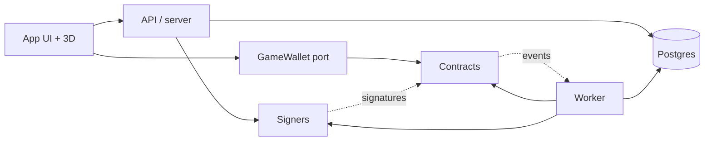
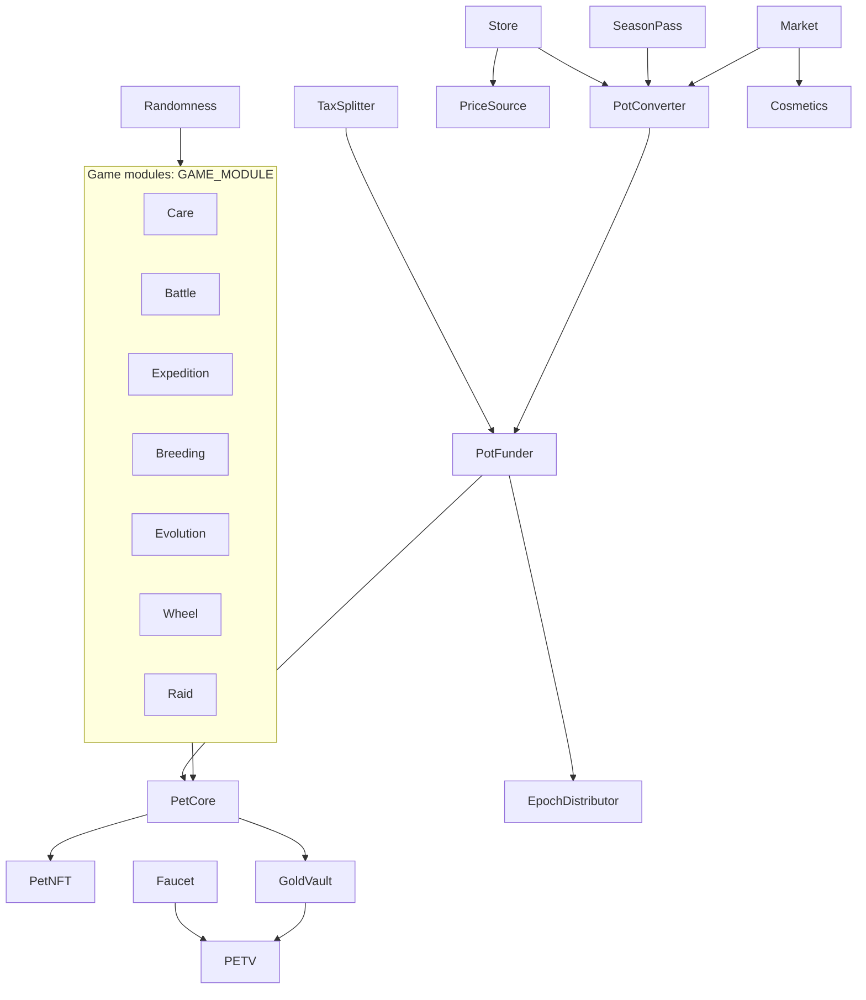
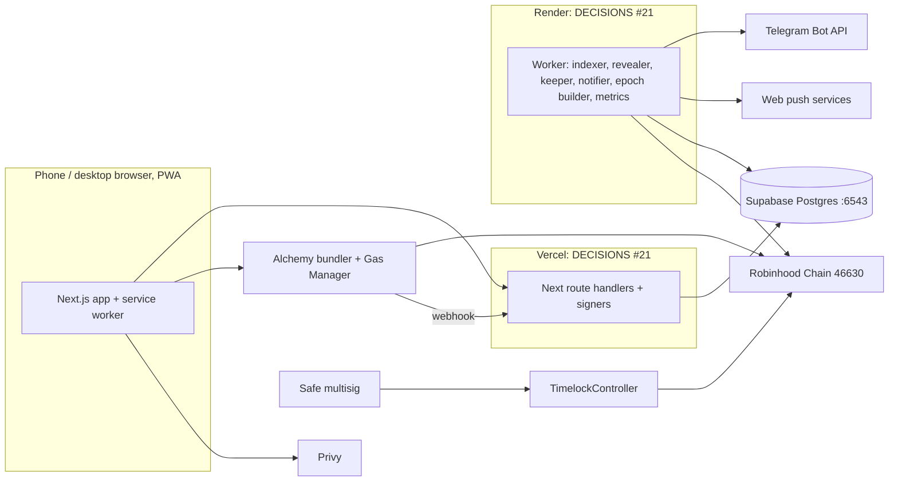
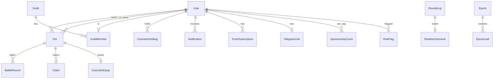

# Architecture Spine: Petverse

## Design Paradigm

**CQRS with the chain as the write model.** Contracts are the only authority for game state that has value or
consequence. The server is a **bounded signer and keeper**, never an authority: it signs inputs (randomness, price
rates, vouchers, Merkle roots) that contracts bound and check, and it pokes time-based transitions. Postgres is a
**read model**: projections rebuilt from chain events, plus data that only exists off-chain.

| Layer | Lives in | May write |
| --- | --- | --- |
| Write model (ledger + rules) | `chain/contracts/` | chain state |
| Signers (randomness, rates, vouchers, epoch roots, risk holds) | `src/server/signers/` | signatures; their own log tables |
| Worker (indexer, revealer, keeper, notifier, epoch builder, metrics) | `src/worker/` | projections, notifications, roots, metrics |
| API (route handlers, server actions) | `src/app/api/`, `src/server/` | off-chain-native tables only |
| App (UI, 3D, service worker) | `src/app/`, `src/components/` | nothing directly; sends txs through `GameWallet` |



Arrows are allowed dependencies. Contracts depend on nothing off-chain. The UI never imports `src/lib/db.ts` or a
signer. A signer never reads projections to decide a value a contract will trust, except the epoch builder (AD-5),
whose full input is published.

## Inherited Invariants

| Inherited | From | Binds here |
| --- | --- | --- |
| #4 Robinhood Chain, testnet 46630 first, mainnet 4663 later | docs/DECISIONS.md | chain config; `chainId` in every signature |
| #5 Privy signer + `@alchemy/wallet-apis` + Gas Manager; not `@account-kit/privy-integration` | docs/DECISIONS.md | AD-8 |
| #6 Fren Pet economy base | docs/DECISIONS.md | AD-2, AD-4 (paid revive superseded by #18) |
| #7 First 10 actions/day sponsored | docs/DECISIONS.md | AD-7 (amended by #19) |
| #8 USD prices paid in $PETV; mainnet Chainlink + Uniswap v3 30-min TWAP; testnet server-signed quotes | docs/DECISIONS.md | AD-10 |
| #9 Teams max 2v2; Death Match 3 lives (amended by #20) | docs/DECISIONS.md | Battle parameters (AD-18) |
| #10 Supabase Postgres via Prisma 7.10 + `@prisma/adapter-pg`; hosted only; app :6543, CLI :5432 | docs/DECISIONS.md | AD-12, AD-13 |
| #11 Verified contracts, multisig owner, time delay before rule changes | docs/DECISIONS.md | AD-3 |
| #12 Server commit–reveal randomness | docs/DECISIONS.md | AD-6 |
| #13 3 days to sleep + 7 days asleep, then death | docs/DECISIONS.md | AD-16 |
| #14 No pet or Co-Pet selling in release 1 (FR-29 selling and FR-30 buy-out dropped) | docs/DECISIONS.md | AD-17, AD-22 |
| #15 Asleep pets get no pot share until woken | docs/DECISIONS.md | AD-4, AD-16 |
| #16 Game Gold paid from a funded reserve with a daily payout cap; no minting of vault shares | docs/DECISIONS.md | AD-2, AD-9, GoldVault (AD-24) |
| #17 Effective-points curve per owner (sum of a wallet's pets), not per pet | docs/DECISIONS.md | AD-4 |
| #18 Wake is free (feed). Supersedes paid revive in #6; point cost clarified by #27 | docs/DECISIONS.md | AD-16 |
| #19 10 sponsored actions/day, 20 with Season Pass | docs/DECISIONS.md | AD-7 |
| #20 No Gladiator pet type; Death Match = any adult pet, 3 lives | docs/DECISIONS.md | AD-18 |
| #21 Next app on Vercel; always-on worker on Render | docs/DECISIONS.md | Structural Seed |
| #22 Testnet PETV graduates into our own Uniswap v2-style pool on 46630 | docs/DECISIONS.md | AD-9 |
| #23 EIP-7702 on the Privy embedded wallet; external wallets that refuse 7702 use ERC-4337 | docs/DECISIONS.md | AD-8 |
| #24 Approved deps: `@privy-io/react-auth`, `@privy-io/node`, `@alchemy/wallet-apis`, `viem` (root app), `web-push`, OZ upgrade-safety validator (dev) | docs/DECISIONS.md | AD-3, Stack |
| #25 Owner numbers N1–N13 (testnet defaults) | docs/DECISIONS.md, owner-numbers.md | AD-3, AD-4, AD-5, AD-6, AD-9, AD-10, AD-15, AD-18 |
| #26 Daily game-Gold payout cap N14 = 0.1% of the Gold reserve per day | docs/DECISIONS.md | AD-24 |
| #27 Wake is free in money but costs 10% of pot points per day asleep (FR-10); clarifies #18 | docs/DECISIONS.md | AD-16, AD-4, AD-18 |
| #28 Small pot = awake living pets in the bottom half by points | docs/DECISIONS.md | AD-5 |
| #29 Co-Pet leave: leaver's half of unclaimed pot paid first, then the pet is the other owner's normal pet; no sale, no money between players | docs/DECISIONS.md | AD-17, AD-4, AD-22 |
| #30 Testnet Safe is 2-of-3 team signers; Safe Protocol Kit / CLI if the Safe web UI lacks 46630 | docs/DECISIONS.md | AD-3 |
| #37 Element does not set coat colour: badge plus accent look; keeps its +10% battle edge (#55) | docs/DECISIONS.md | AD-18 (battle math); UI only otherwise |
| #38 Every hand item fits all 10 species: babies and winged species get a hand anchor | docs/DECISIONS.md | AD-22 (Cosmetics; visual only, AD-1) |
| #39 Resolved EXPERIENCE open questions win; install prompt after the first feed with the push ask | docs/DECISIONS.md | AD-19, Deferred (UX items) |
| #40, #41 Flagged accounts out of epoch payouts and sponsorship until cleared; main-pot hold self-expires at 72h; every back-to-back renewal needs the Safe, which renews or clears directly | docs/DECISIONS.md | AD-15, AD-5 |
| #42, #43 Alert kinds and channels; pill newest, push and Telegram most urgent | docs/DECISIONS.md | AD-19 |
| #44 "Check this result" covers all nine CAP-28 result types plus claims | docs/DECISIONS.md | AD-6 (`RevealLog`, public seeds) |
| #45 Gas Manager balance alarm from webhook spend against an owner-entered budget | docs/DECISIONS.md | AD-23 |
| #46 `IPriceSource` and the signed quote carry `weiPerUsd` | docs/DECISIONS.md | AD-10, AD-11 |
| #47 Faucet pays fixed N11 / N12 amounts; UI shows their live dollar value | docs/DECISIONS.md | AD-9 |
| #48, #49 `seasonPool` holds and pays PETV; Guild War Gold uses a weekly `guildWar` stream from the Gold reserve | docs/DECISIONS.md | AD-5, AD-24 |
| #50 Season skin is a soulbound per-season item granted when the Pass is bought | docs/DECISIONS.md | AD-22 (soulbound cosmetics) |
| #51 Wheel resets on a rolling 24h per player | docs/DECISIONS.md | Consistency Conventions |
| #52 Death Match win = 2 × (10% of the opponent's pot points) × min(streak, 5), new points, not taken | docs/DECISIONS.md | AD-18 |
| #53 Gold vault grows only from the 2% swap-back fee in release 1 | docs/DECISIONS.md | AD-24 |
| #54 Trade tax taken in ETH; pot share straight to PotFunder | docs/DECISIONS.md | AD-9, AD-11 |
| #55 Element edge: +10% battle power when the attacker's element beats the target's; cycle fire > leaf > stone > spark > water > fire | docs/DECISIONS.md | AD-18, AD-6 |
| #56 A confirmed bot pet's unclaimed pot ETH is recycled into the main pot once the Safe confirms; its points are zeroed | docs/DECISIONS.md | AD-15, AD-4 |
| #57 Death Match cap: 20 fights per pet per weekend | docs/DECISIONS.md | AD-18 |

## Invariants & Rules

### AD-1: Points-affecting actions are on-chain; the server only signs bounded inputs

- **Binds:** all FRs; every unit.
- **Prevents:** one feature granting value in the DB while another does it on-chain, so the two diverge.
- **Rule:** Any action that changes points, effective points, ETH owed, $PETV, Gold, lives, pet status, care window,
  evolution stage, rank, cosmetics held, badges or NFT ownership is a contract call. This includes feed, wake, attack,
  revenge, duel, 2v2, Death Match, Guild War match, Boss Raid, monsters, wheel, login streak, expeditions, breeding,
  evolution, store, pass, wager, dice, market, vault, faucet, claim. Off-chain only: profiles, cosmetic equip (visual
  only), guild membership and roles, matchmaking queues, invites, notification settings, push and Telegram links, risk
  flags, telemetry. Matchmaking may pick opponents off-chain; the contract re-checks eligibility (level ±2, shields,
  cooldowns, protection, same-owner ban) at settlement.

### AD-2: PetCore is the single ledger; modules are spokes

- **Binds:** FR-6–16, FR-19–38, FR-44, FR-48–53.
- **Prevents:** two modules writing points or life state with different settlement order, multipliers or reentrancy
  rules.
- **Rule:**
  - `PetCore` alone stores per-pet points, `sleepAt`, asleep flag, care-window counter, lives, shield / cooldown /
    protection timestamps, co-owner, accrued-but-unpaid Gold counter, the per-bucket effective points (AD-4) and the pot
    accumulators.
  - Game modules (Care, Battle, Expedition, Breeding, Evolution, Wheel, Raid) change pets only through
    `PetCore.touch`, `awardPoints`, `transferPoints`, `burnPoints` and life setters, gated by `GAME_MODULE`. PetCore
    alone applies multipliers (Season Pass +25%, Co-Pet Together bonus), settles pending ETH before any share change,
    and forbids `transferPoints` between pets of the same owner or co-owner.
  - One reentrancy lock in PetCore covers every entry point. ETH is paid last; a failed push becomes a pull balance.
  - Modules that move only tokens (Wager, Dice, Market, Store, GoldVault) never touch points.
  - Gold balances live only in `GoldVault`; PetCore pays accrued Gold through `GoldVault.creditFromGame`, which only
    PetCore may call and which pays from the funded Gold reserve, never by minting (AD-24). "Dead pet's Gold returns to
    the vault" = PetCore deletes the unpaid counter, so the Gold stays in the reserve.



### AD-3: Upgradeable modules behind a Safe-proposed timelock

- **Binds:** every contract; NFR-1; DECISIONS #11, #30.
- **Prevents:** a single key changing rules or swapping logic, units choosing different admin or storage patterns, and
  upgrades that corrupt storage.
- **Rule:**
  - Each stateful contract is a UUPS proxy (OpenZeppelin upgradeable 5.6.1) with ERC-7201 namespaced storage; no
    Diamond. The gate runs the OpenZeppelin upgrade-safety validator (dev dependency, DECISIONS #24) on build output.
  - The upgrade admin and every parameter setter is one OZ `TimelockController`. Its proposer and canceller is a Safe
    (Safe contracts are canonical on 46630 and 4663); executor is open. Delay: 1 hour on testnet, 48 hours hinted for
    mainnet (N1).
  - Testnet Safe: 2-of-3 team signers (DECISIONS #30), so one lost key is not fatal. If the Safe{Wallet} web UI does not
    list 46630, signers propose, sign and execute through Safe Protocol Kit / Safe CLI against the canonical contracts;
    the deploy runbook covers both paths. Mainnet signer count and key storage are decided with mainnet work.
  - The Safe holds `PAUSER`: it can pause a module or suspend a signer role instantly, but cannot change parameters,
    upgrade, or move funds.
  - Each server key holds exactly one role (`RANDOMNESS_SIGNER`, `QUOTE_SIGNER`, `VOUCHER_SIGNER`, `EPOCH_POSTER`,
    `RISK`, `KEEPER`), granted and rotated only through the timelock.
  - `PETV` is not upgradeable and has no mint after deploy.
  - Deploys use Hardhat Ignition modules in `chain/ignition/modules/`. Every contract is source-verified on Robinhood's
    Blockscout explorer (custom chain entry in `chain/hardhat.config.ts`) before players are pointed at it.

### AD-4: Pot accounting is a two-level MasterChef accumulator over per-owner effective points

- **Binds:** FR-11, FR-14–17, FR-52; NFR-2, NFR-3; DECISIONS #15, #17.
- **Prevents:** loops over players or pets, ETH entering the pot two ways, gaining by splitting points across pets,
  asleep pets earning, and units computing a share differently.
- **Rule:**
  - New ETH enters only through `PotFunder`. `PotFunder` buffers incoming ETH; `flush()` sends 85% to PetCore's main
    accumulator and 15% to `EpochDistributor`'s small-pot stream. `flush()` is `KEEPER`-only, or open to anyone once the
    buffer has waited more than 1 day (liveness).
  - **Buckets.** Each pot share belongs to a bucket: one bucket per owner address (all that owner's solo pets), and one
    bucket per Co-Pet (the Co-Pet alone, under neither owner's total). A bucket's `rawPoints` = sum of points of its
    **awake** living pets. Bucket `eff = eff(rawPoints)`; `totalEffPoints` = Σ bucket `eff`.
  - Effective points come from one library: `eff(p) = p` for `p ≤ K`, else `floor(sqrt(p × K))`; `K` is a timelocked
    parameter, 10,000 points on testnet (N2).
  - **Level 1 (global → bucket):** `accEthPerEffPoint += amount × 1e18 ÷ totalEffPoints`. Per bucket `rewardDebt`;
    bucket pending = `eff × acc ÷ 1e18 − rewardDebt`. With `totalEffPoints = 0` the amount waits in `undistributed` and
    is added on the next flush.
  - **Level 2 (bucket → pet):** settling a bucket moves its pending into the bucket's own
    `accEthPerRawPoint += pending × 1e18 ÷ rawPoints`. Per pet `rewardDebt` and `ethOwed`; pet pending =
    `petPoints × bucketAcc ÷ 1e18 − rewardDebt`. So a pet's share = `petPoints × eff(ownerTotal) ÷ ownerTotal` of what
    its bucket earned.
  - **Settle order** whenever any pet's counted points change (award, steal, burn, claim, sleep, wake, Co-Pet start or
    end, bury): settle the bucket (level 1 then level 2), settle the pet, change `rawPoints`, recompute bucket `eff`,
    move `totalEffPoints` by the delta, reset both debts. A change in one pet never needs a loop over the owner's pets.
  - **Asleep pets (#15).** A sleeping pet's points leave its bucket and rejoin on wake; its `ethOwed` and level-2
    pending up to the sleep stay its own. Asleep is time-based (`sleepAt`), so removal is done by
    `PetCore.sleep(petId)`, callable by anyone once `now ≥ sleepAt` and also run inside `touch`. Each keeper tick runs
    `sleep` for every due pet, then `bury` (AD-16), then `PotFunder.flush()`; so no flush pays a pet past its `sleepAt`
    while the keeper is live. Tests pin: a flush after `sleep` adds nothing to that pet;
    wake re-adds its points after the AD-16 wake cut.
  - Recycled ETH (a buried pet's owed + pending, or a confirmed bot pet's owed + pending via `recycleBotPet`, AD-15,
    DECISIONS #56) stays inside PetCore and goes 100% to the main accumulator, after the pet's points are out of its
    bucket. `flush()` is never used for recycled ETH.
  - Claim order: settle, pay `ethOwed + pending` (split 50/50 for a Co-Pet), set the pet's points and `rewardDebt` to
    0 and update its bucket. A `payoutHold` holds the whole claim.
  - Invariant pinned by tests: PetCore's ETH balance = Σ pet owed + Σ pet pending + Σ bucket pending + undistributed +
    pull balances.
  - Views expose pot size, a pet's pending ETH, its bucket and the inputs, so anyone can check them.

### AD-5: Ranked and bottom-half payouts go through one epoch Merkle distributor

- **Binds:** FR-15, FR-32, FR-36, FR-47, FR-51, FR-53; §4.10 anti-bot "older than 7 days"; DECISIONS #15, #28.
- **Prevents:** O(n) sorts on-chain, units choosing different snapshots, and roots that pay more than was funded.
- **Rule:**
  - One `EpochDistributor` contract with named streams: `smallPot` (ETH), `seasonPool` (season bonus in PETV, fed by
    20% of Season Pass income; DECISIONS #48), `guildWar` (weekly Guild War Gold prize, paid from the Gold reserve under
    the N14 cap; DECISIONS #49), `trophies` (top-10% season trophy, top raid teams' cosmetic). Epoch length and genesis for each stream are
    on-chain parameters; the season boundaries live on-chain in `SeasonPass` (`seasonOf(ts)`, `isActive(addr, ts)`).
  - At epoch end the worker waits for `epochEnd + confirmations` and for the indexer to pass the snapshot block, then
    builds leaves keyed by `petId` (or `guildId` → member addresses for Guild War) and posts
    `(stream, epoch, root, datasetHash, total)` via `EPOCH_POSTER`. The contract rejects `total` above what the stream
    received plus rollover.
  - Small pot leaves (DECISIONS #28): pets **awake** at the snapshot block, older than 7 days, not on hold or flagged;
    the bottom half of that set by raw points; equal shares. Awake at the snapshot block = the AD-16 status port says
    not asleep and not dead at that block's timestamp (`snapshotTs < sleepAt`, using `sleepAt` as of that block),
    whether or not `sleep(petId)` was called. Asleep and dead pets are dropped before the bottom-half cut, so they
    neither get a share nor move the cut line. Tests pin a pet with `sleepAt == snapshotTs` as excluded.
    Guild War rosters and results are part of the published dataset.
  - Testnet epochs (N3–N5): `smallPot` weekly, ending Sunday 00:00 UTC; `seasonPool` and `trophies` one season (12
    weeks); `guildWar` weekly (Sunday).
  - Flagged accounts (AD-15) are left out of every stream's leaves until a reviewer clears them (DECISIONS #40).
  - A root is claimable after a delay (1 hour on testnet, N6); the Safe can cancel it within the delay. `datasetHash`
    covers the snapshot block number and hash. The full dataset is served by a public API route so anyone can rebuild
    the root. Unclaimed amounts roll into a later epoch after 4 epochs (N7).

### AD-6: Commit–reveal randomness, bound per request, no chain entropy

- **Binds:** FR-6, FR-18–27, FR-37, FR-38, FR-40, FR-48, FR-50, FR-53; NFR-1.
- **Prevents:** replayed commitments, a server that picks or previews outcomes for chosen actions, reliance on
  `blockhash` (unreliable on Robinhood Chain, an Arbitrum Orbit chain), and modules inventing their own schemes.
- **Rule:** One `Randomness` contract serves all modules.

```mermaid
sequenceDiagram
  participant P as Player wallet
  participant S as Signer service
  participant M as Game module
  participant R as Randomness
  P->>S: ask commitment (player only, no action details)
  S->>S: requestId = keccak(chainId, Randomness, player, playerNonce); secret = HMAC(key, requestId)
  S-->>P: commitment = keccak(secret), EIP-712 sig over (requestId, player, commitment, expiry)
  P->>M: act(params, commitment, sig)
  M->>R: register(requestId, commitment, module); playerNonce++
  S->>R: reveal(requestId, secret)
  R->>M: settle(requestId, seed = keccak(secret, requestId))
```

  - The signature binds the player and on-chain nonce, never the action or target, so the signer cannot select which
    actions to serve by outcome.
  - A request not revealed within the reveal timeout (10 minutes, N8) can be closed by anyone with the same no-op for both sides
    (stakes refunded, no points move). Late reveals raise an alert.
  - A settle for a pet that has been buried takes the same no-op.
  - The secret is revealed in an event; `RevealLog` stores it only after the reveal. The signer role can only
    register commitments and reveal.
  - The tutorial bot battle (FR-5) is a deterministic win with no randomness.

### AD-7: Gas sponsorship cap is enforced by our Gas Manager webhook

- **Binds:** FR-3, FR-4, FR-43; DECISIONS #7, #19.
- **Prevents:** uncapped sponsorship, cap bypass through batching or extra wallets, and units counting "actions"
  differently.
- **Rule:**
  - One Alchemy Gas Manager policy for the game contracts, with a custom-rules webhook to `/api/gas/approve`;
    `approveOnFailure` is false (fail closed). The route verifies Alchemy's webhook signature.
  - One action = one sponsored user operation whose calldata is a single call to an allow-listed game contract; anything
    else is refused.
  - The count is per Privy DID per UTC day (`SponsorshipCount`), mapped from `userOperation.sender`; cap 10, or 20
    while `SeasonPass.isActive` is true (DECISIONS #19). Flagged accounts (AD-15) are refused.
  - Over the cap, the client sends the same call unsponsored, paid from the player's test ETH.

### AD-8: Wallet and identity

- **Binds:** FR-2, FR-3; DECISIONS #5, #23.
- **Prevents:** identity keyed by different things in different units; UI code that cannot run against a local node.
- **Rule:**
  - Player identity = Privy user DID, verified server-side from the Privy access token (ES256 JWT, verified locally
    with the app's verification key) on every API call.
  - The on-chain identity is the account address that sends the player's user operations (`userOperation.sender`),
    built with `@alchemy/wallet-apis` on the Robinhood chain definition. `User` rows are keyed by Privy DID and hold that
    address; one DID may link more than one address only through an explicit link step.
  - Account mode: EIP-7702 on the Privy embedded wallet, so the account address is the embedded wallet's own address.
    An external wallet that refuses 7702 falls back to an ERC-4337 smart account owned by that wallet; that smart
    account address is the player's on-chain identity. Both go through the same Gas Manager policy (AD-7).
  - UI and hooks send transactions only through a `GameWallet` port. Production adapter = Alchemy wallet; test adapter
    = viem wallet client on the Hardhat local node.

### AD-9: $PETV on testnet: fixed-supply token, our Pons-like curve, one tax splitter

- **Binds:** FR-17, FR-41, FR-45; §4.10 money and test funds.
- **Prevents:** tax logic spread across the token, the curve and the pool; a mintable token; a faucet with no source.
- **Rule:**
  - `PETV` is a plain ERC-20, 1B supply minted once at deploy into fixed allocations (N13): curve 40%, liquidity 20%,
    faucet 15%, Gold reserve 15% (AD-24), team 10%. No owner mint, no transfer tax in the token.
  - On testnet the curve graduates into our own Uniswap v2-style pair and router deployed on 46630 (DECISIONS #22),
    seeded from the liquidity allocation.
  - The 5% trade tax is taken in ETH by the venue (`PonsLikeCurve` before graduation, our v2-style pool after) and
    sent to `TaxSplitter`, which splits by timelocked basis points (default 2% pot, 1% burn, 1% liquidity, 1% team) and
    sends the pot share to `PotFunder` as ETH (no PotConverter). For the burn share it buys PETV tax-free through the
    venue with a minimum-out and burns it; the liquidity share is paired into the pool (held until graduation)
    (DECISIONS #54).
  - On mainnet, `TaxSplitter` is the Pons creator-tax recipient and `PonsLikeCurve` is not deployed.
  - Burns call `burn` or send to the dead address, and emit `Burned(source, amount)`, which the burn counter reads.
  - `Faucet` (testnet only) pays test $PETV from its allocation and test ETH the team tops up, once at sign-up and once
    per UTC day, against a `VOUCHER_SIGNER` voucher per Privy DID; amounts are timelocked parameters (N11: 0.01 test
    ETH + 3,120 PETV at sign-up; N12: 0.002 test ETH + 624 PETV daily). The amounts are fixed in PETV; the app shows
    their live dollar value (DECISIONS #47).

### AD-10: Dollar pricing through one price-source port with bounded signers

- **Binds:** FR-42, FR-43, FR-45; DECISIONS #8.
- **Prevents:** each store-like module reading prices its own way; a leaked quote key buying everything for 1 wei.
- **Rule:**
  - USD prices (cents) for every item live on-chain in `Store` / `SeasonPass` as timelocked parameters. Every
    USD-priced payment converts through `IPriceSource.petvPerUsd()`; `IPriceSource.weiPerUsd()` gives the ETH rate
    PotConverter needs (DECISIONS #46).
  - Testnet `SignedRateSource`: `QUOTE_SIGNER` signs only `(petvPerUsd, weiPerUsd, burnStageBps, expiry, nonce)` via
    EIP-712. The contract rejects either rate if it moves more than a set bps per hour from the last accepted rate (5% per hour on
    testnet, N10), and a burn stage other
    than 7000, 5000 or 3000.
  - Mainnet: an adapter over Chainlink ETH/USD and a Uniswap v3 30-minute TWAP behind the same interface.
  - The burn stage comes from the price source, never from the caller.

### AD-11: Revenue in $PETV reaches the ETH pot only through PotConverter

- **Binds:** FR-17, §4.10 store, pass and market splits.
- **Prevents:** modules swapping $PETV to ETH on their own, or sending $PETV into the ETH pot.
- **Rule:** Store, SeasonPass and Market send the pot share of $PETV income to `PotConverter`. A keeper triggers batch
  swaps to ETH with a minimum-out from `IPriceSource` (`petvPerUsd` and `weiPerUsd`); the ETH goes to `PotFunder`. Team, season-pool (PETV, DECISIONS #48) and
  burn shares go to their fixed destinations in the same transaction as the sale. The trade tax pot share is already
  ETH and skips PotConverter (AD-9).

### AD-12: One schema, one writer per table; the indexer owns projections

- **Binds:** NFR-6; all server and worker units.
- **Prevents:** two units writing the same table, and DB rows that contradict the chain.
- **Rule:**
  - One `prisma/schema.prisma`. Every model has a comment naming its single writer module (e.g. `Notification` =
    notifier, `NotificationSettings` = API, `SponsorshipCount` = gas webhook, `EpochLeaf` = epoch builder).
  - Projection models (pets, points, ownership, battles, claims, burns, cosmetics held, badges) are written only by
    the indexer, from chain events.
  - On-chain entities use chain ids as keys: `tokenId` as decimal string, addresses lowercase hex, `chainId` on every
    projection row.
  - Migrations are made with the Prisma CLI over `DIRECT_URL` only; the app connects only through `src/lib/db.ts` over
    `DATABASE_URL`.

### AD-13: Environments are Postgres schemas in the one hosted database

- **Binds:** NFR-6; DECISIONS #10; PRD open question 6.
- **Prevents:** tests or local dev wiping live data, and live tables exposed through Supabase's Data API.
- **Rule:**
  - One env value, `DB_SCHEMA`, is the only source of the schema. `src/lib/db.ts` passes it to `PrismaPg({ schema })`;
    the CLI gets it as `?schema=` on `DIRECT_URL`; raw SQL sets `search_path` to it.
  - Schemas: `game` = live testnet; `dev` = local development; `test_<runid>` = one test run, created, migrated and
    dropped by the test setup. Nothing lives in `public`.
  - The test setup refuses to run unless `DB_SCHEMA` starts with `test_`. Seed and reset scripts refuse `game`.
  - The Supabase Data API does not expose `game` or `dev`, and RLS is on for every table.
  - A smoke test runs one query through the :6543 pooler in a `test_` schema.

### AD-14: Indexer is one in-repo worker with a cursor and idempotent writes

- **Binds:** FR-14, FR-20, FR-47, FR-51; all read screens.
- **Prevents:** duplicate or missing projection rows after restarts and reorgs.
- **Rule:** The worker reads logs with viem `getLogs` up to `head − confirmations`, keeps its position per contract in
  `IndexerCursor`, and upserts by `(chainId, txHash, logIndex)`. It can rebuild every projection from the deploy block.
  Money reads (claimable ETH, pending, vault value) come from contract views, never projections.

### AD-15: Anti-bot uses off-chain detection and a narrow on-chain hold

- **Binds:** FR-6, FR-12, FR-51; §4.10 anti-bot; counter-metrics; DECISIONS #40, #41, #56.
- **Prevents:** free-egg farming with fresh wallets, and a server key that can take funds.
- **Rule:**
  - Free eggs (starter and after death) and faucet drips need a `VOUCHER_SIGNER` voucher bound to a Privy DID (email or
    Google verified) or a wallet that passes the history check. The contract caps vouchers per DID hash.
  - Risk flags live off-chain in `RiskFlag`. `RISK` can set an on-chain `payoutHold` on a pet; a hold only delays
    claims, expires on its own after 72 hours (N9); `RISK` cannot set a new hold on the same pet within 72 hours after the
    last one ended, so every back-to-back renewal (no count limit) needs the Safe; `RISK` may lift a hold it set; the Safe
    renews or clears holds directly, not through the timelock, because a hold moves no funds and changes no rule
    (DECISIONS #41). A hold also blocks the pet's EpochDistributor claims and a Co-Pet's whole claim.
  - Flagged accounts are excluded from epoch snapshots and refused gas sponsorship until a reviewer clears them
    (DECISIONS #40).
  - **Confirmed bot (DECISIONS #56).** Once a reviewer confirms a flag, the Safe calls `PetCore.recycleBotPet(petId)`
    (Safe-gated, direct like hold renewals, not through the timelock; `RISK` cannot call it). In one transaction it
    settles the bucket and the pet (AD-4), recycles the pet's owed + pending ETH to the main accumulator the same way
    bury does, takes the pet's points out of its bucket and sets them to 0, recomputes `eff` and resets debts, and
    emits `BotPetRecycled(petId, amount)`. The pet stays alive. A Co-Pet's whole unclaimed ETH is recycled. Tests pin:
    the AD-4 balance invariant holds, the pet's claimable ETH and points are 0, and only the Safe can call it.

### AD-16: Life cycle comes from one timestamp

- **Binds:** FR-7–13, FR-25; DECISIONS #13, #15, #18, #27; PRD open question 8.
- **Prevents:** different status answers at the boundaries in contract, worker and UI, modules acting on a dead
  pet, and asleep pets earning.
- **Rule:**
  - PetCore stores `sleepAt` (last feed + 3 days); `deathAt = sleepAt + 7 days`. Asleep iff `sleepAt ≤ now < deathAt`;
    dead iff `now ≥ deathAt` (the boundary is dead). Wake = a normal feed while `now < deathAt`; it costs no money
    (DECISIONS #18) but cuts pot points (DECISIONS #27).
  - Wake point loss: `daysAsleep = floor((now − sleepAt) ÷ 1 day) + 1` (1..7); the pet loses
    `points × min(daysAsleep × wakeLossBps, 10,000) ÷ 10,000` pot points; `wakeLossBps` is a timelocked parameter,
    1,000 (10%) on testnet (AD-18). Level, lifetime points, items and lives are untouched. The UI states the loss first.
  - Wake order (AD-4): run `sleep` first if not done, which settles the bucket and the pet as of the sleep, so the
    pre-sleep share is already in `ethOwed`; then cut the out-of-bucket points; then settle the bucket, add the reduced
    points, recompute `eff` and reset debts. The cut never touches `ethOwed`: ETH earned before sleep stays claimable.
    Lost points are destroyed, not moved. Tests pin day 1 = 10%, day 7 = 70%, and `ethOwed` unchanged by a wake.
  - Pot share follows status, not the timestamp alone: `sleep(petId)` (anyone, once `now ≥ sleepAt`; also inside
    `touch`) takes the pet's points out of its bucket; wake puts them back (AD-4). The status port reports asleep from
    `sleepAt`; the `asleep` flag only says whether the points were already taken out.
  - `PetCore.touch(petId) returns (Status)` is the only bury-on-touch hook. A module that gets `Dead` ends the action
    with no state change for that pet (stakes refunded, no revert), so the bury stands. The keeper also calls `bury` for
    every due pet.
  - Bury: run `sleep` first if not done, recycle owed + pending ETH (AD-4), delete the Gold counter (AD-2), burn the NFT,
    mint a soulbound Tombstone, and issue the free-egg right.
  - UI and worker use one TS port of the status rule, pinned to the contract by shared test vectors.

### AD-17: Co-Pet ownership is on-chain

- **Binds:** FR-25, FR-28–30; DECISIONS #14, #17, #29.
- **Prevents:** a second owner who exists only in the DB, replayed approvals, and Co-Pet sales.
- **Rule:** PetCore holds `coOwner` per pet. Both owners may care and play; claims pay 50/50. A Co-Pet has its own pot
  bucket (AD-4). Actions needing both owners (Death Match entry, breeding) need an on-chain approval
  `(petId, action, nonce, expiry)` from each, used once and voided by any ownership change. No Co-Pet selling or
  buy-out (DECISIONS #14). At most 3 Co-Pets per player, checked on-chain.
- **Leave (DECISIONS #29).** Either owner calls `leaveCoPet(petId)`; "end" is the same call. No price and no payment
  between players. One transaction, in order:
  1. `touch` the pet (a dead pet is buried instead, AD-16); settle the Co-Pet bucket and the pet (AD-4).
  2. Pay the leaver half of the pet's unclaimed ETH (`ethOwed + pending`) to the leaver's pull balance (a
     `payoutHold` on the leaver holds it); the other half stays in the pet's `ethOwed`. Accrued unpaid Gold splits
     the same way.
  3. Take the pet's points out of the Co-Pet bucket and close it; clear `coOwner`; void open approvals.
  4. The remaining owner is sole owner (PetCore moves the NFT if the leaver held it, the no-payment move in AD-22);
     settle that owner's per-owner bucket, add the pet's points if awake (an asleep pet joins on wake), recompute
     `eff`, reset debts. From here it is a normal solo pet under that owner's curve.
  5. Mint the leaver a soulbound memory badge; decrement both owners' Co-Pet counts.
  Tests pin: the leaver gets exactly half, the remaining owner's later claim gets the other half, the AD-4 balance
  invariant holds, and the pet counts in the remaining owner's `eff`.

### AD-18: Every economy number is a parameter with one home

- **Binds:** §4.10; all modules; DECISIONS #25, #26, #37, #52, #55, #57.
- **Prevents:** the same number hard-coded differently in contract, server and UI.
- **Rule:** On-chain numbers (cooldowns, steal %, tax and split bps, timers, caps, `K`, epoch lengths, prices) live in
  the contract that uses them and change only through the timelock; the UI and server read them from contract views.
  Off-chain numbers (matchmaking range, notification caps) live in one `GameConfig` table written only by an admin
  script. Tests pin the current defaults; changing a value is an owner decision. Testnet defaults are N1–N14 in
  `owner-numbers.md` (DECISIONS #25, #26); N14 is the daily game-Gold cap that every Gold reward (monsters, living
  pets, Boss Raid, Guild War) counts toward (AD-24).
- **Battle parameters:** teams at most 2v2; Death Match is open to any adult pet and uses 3 lives; there is no
  Gladiator pet type in release 1 (DECISIONS #9, #20).
  - Win chance = `A ÷ (A + D)` from the attacker's and defender's battle power. When the attacker's element beats the
    target's, A gets +10% (`elementEdgeBps` = 1,000, timelocked) before the formula. Cycle: fire beats leaf, leaf
    beats stone, stone beats spark, spark beats water, water beats fire; any other pair gets no edge (DECISIONS #37,
    #55). The roll uses the AD-6 seed. Tests pin each of the five winning pairs, a reverse pair and a same-element pair.
  - Death Match: at most 20 fights per pet per weekend (`deathMatchFightCap`, timelocked param, DECISIONS #57),
    counted on-chain per pet per Death Match weekend and checked at entry. Win reward = 2 × (10% of the opponent's
    pot points) × min(streak, 5), awarded as new points, not taken from the opponent (DECISIONS #52).

### AD-19: Notifications come from projections and never block play

- **Binds:** FR-20; EXPERIENCE.md Notifications; NFR-4.
- **Prevents:** each feature sending its own alerts, and time-based alerts that never fire.
- **Rule:**
  - The notifier writes `Notification` rows from indexed events (robbed, passed away from `PetBuried`, claim ready,
    Co-Pet partner needs to agree, partner left), deduped by `(chainId, txHash, logIndex)`, and from time-based states
    (hungry, asleep, close to passing away = 24h before `deathAt`) computed from projected `sleepAt` with the AD-16
    status port, deduped by `(petId, kind, sleepAt)` (DECISIONS #42).
  - Robbed, hungry, asleep, close to death and passed away go to all channels; claim ready, wheel ready, streak at risk
    and Co-Pet alerts are in-app only. The in-app pill shows the newest unread; push and Telegram send only the most
    urgent due alert per tick, max 3 pushes a day, no pushes 22:00–08:00 local except close to death (DECISIONS #43).
  - Channels: in-app, web push (VAPID, through the app's service worker), Telegram bot. No email.
  - Telegram linking uses `t.me/<bot>?start=<token>` with a one-time token of up to 64 `[A-Za-z0-9_-]` characters.
  - Delivery failures are retried and logged, never surfaced as game errors.

### AD-20: Test strategy

- **Binds:** DECISIONS #2; all units.
- **Prevents:** tests that touch live data or accounts, and contract rules tested only through the UI.
- **Rule:**
  - Contract tests live in `chain/test/` and use Hardhat 3's in-process network, viem and `node:test` (no mocha). They
    pin every §4.10 default and the boundaries of AD-4 (balance invariant), AD-5 (`total` cap), AD-6 (timeout no-op),
    AD-16 (exact `deathAt`), AD-4 (no share while asleep, per-owner curve) and AD-24 (daily cap, no share minting).
  - Server and worker tests run on a `test_` schema (AD-13) and a Hardhat local node with the contracts deployed by the
    Ignition module.
  - Privy, Alchemy (bundler, Gas Manager webhook), web push and Telegram are local fakes or recorded fixtures. No test
    uses a real key, account or network.

### AD-21: Contract addresses and ABIs reach `src/` through one generated module

- **Binds:** every unit that calls a contract.
- **Prevents:** hard-coded or stale addresses and hand-copied ABIs.
- **Rule:** A script turns Ignition's deployment output and the Hardhat artifacts into one generated TS module per
  chainId in `src/lib/chain/`. App, server and worker import addresses and ABIs only from there.

### AD-22: Transfer rules

- **Binds:** FR-12, FR-29, FR-30, FR-39, FR-40, FR-44, FR-46; PRD §7; DECISIONS #14.
- **Prevents:** one unit allowing transfers that another assumes cannot happen.
- **Rule:**
  - No pet or Co-Pet selling in release 1. `PetNFT` is minted and burned only by PetCore; every other transfer
    reverts, except PetCore's no-payment Co-Pet end / leave flow (AD-17). `Market` never lists `PetNFT`.
  - `Cosmetics` is one ERC-1155 for all rarities. Commons, Tombstones, memory badges, trophies and egg-shards are
    soulbound. Rare and above transfer freely and trade on `Market`.
  - Gold (vault shares) cannot be sent to contracts that are not allow-listed (as Fren Pet's pGOLD).

### AD-23: Testnet operations

- **Binds:** NFR-1; PRD §6 counter-metrics; AD-6, AD-14, AD-16.
- **Prevents:** a silent stall in the revealer, keeper or indexer, and counter-metrics nobody can measure.
- **Rule:**
  - The worker exposes a health route and alerts on indexer lag, reveal backlog or late reveals, keeper backlog,
    signer ETH balance and Gas Manager spend: sponsored spend summed from the gas webhook against an owner-entered
    budget in `GameConfig`, alarmed at a threshold; Alchemy's policy balance is read directly only if an API exposes
    it (DECISIONS #45).
  - A metrics job reads projections daily and stores the four counter-metrics (bot share of payouts, top-5% share,
    robbed-new-player week-1 churn, re-hatch after death) in `MetricDaily`.

### AD-24: Game Gold is paid from a funded reserve with a daily cap

- **Binds:** FR-32, FR-44, FR-50; DECISIONS #16, #26, #49, #53; N13, N14.
- **Prevents:** game rewards diluting Gold stakers, and an unbounded drain of the reserve in one day.
- **Rule:**
  - `GoldVault` never mints vault shares for game rewards. Shares are minted only for real $PETV deposits.
  - At deploy the 15% Gold reserve allocation of $PETV is deposited into `GoldVault` once; the shares it gets are held
    by the vault's reserve account. `creditFromGame` (PetCore only) moves existing shares from the reserve to the
    player.
  - A daily payout cap (timelocked parameter, UTC day; testnet 0.1% of the reserve, N14, DECISIONS #26) limits all `creditFromGame` paid per day. Credit over the cap, or
    when the reserve is empty, stays in the pet's unpaid Gold counter in PetCore and pays on a later day.
  - Guild War Gold prizes come from the same reserve through `EpochDistributor`'s weekly `guildWar` stream and count
    toward the same cap (DECISIONS #49).
  - In release 1 the vault grows only from the 2% swap-back fee (kept in the vault) and an open add-PETV path; no store,
    pass, market or tax share is routed to it (DECISIONS #53).
  - Views expose reserve size, today's paid amount and the cap.

## Consistency Conventions

| Concern | Convention |
| --- | --- |
| Contract names | PascalCase, one contract per file in `chain/contracts/`; interfaces `I*` in `chain/contracts/interfaces/` |
| Events | Past tense (`PetFed`, `PetRobbed`, `PotFunded`, `PetBuried`, `Burned`); every state change emits one; indexer handlers named after the event |
| Amounts | On-chain integers only: wei, token base units, basis points, USD cents; JSON carries them as decimal strings |
| Time | Unix seconds on-chain; UTC everywhere; "day" = UTC day for caps and faucet; the free wheel spin is a rolling 24h per player from the last spin (DECISIONS #51) |
| Ids | `tokenId` as decimal string; addresses lowercase hex; Privy DID for users; `requestId` = bytes32 hex |
| Signatures | EIP-712, domain name `Petverse`, version, `chainId`, verifying contract; every signed struct has `expiry` and `nonce` |
| API errors | `{ error: { code, message } }` with HTTP status; codes are SCREAMING_SNAKE |
| Secrets | Hardhat `configVariable` / keystore for chain; host env for server keys; never logged (CLAUDE.md) |
| DB access | Server only, through `src/lib/db.ts`; no DB import in client components |

## Stack

| Name | Version |
| --- | --- |
| Next.js (App Router) | 15.5.27 |
| React | 19.1.0 |
| three / @react-three/fiber / drei | 0.186.1 / 9.8.1 / 10.7.9 |
| zustand | 5.0.15 |
| Hardhat (+ toolbox-viem, Ignition) | 3.19.0 (5.0.7) |
| Solidity | 0.8.28, evm cancun, viaIR |
| viem | 2.57.x |
| OpenZeppelin contracts / contracts-upgradeable | 5.6.1 |
| Prisma + @prisma/adapter-pg | 7.10.x |
| Postgres (Supabase) | 17.11 |
| @alchemy/wallet-apis | 5.3.0 (approved, DECISIONS #24) |
| @privy-io/react-auth | 3.49.0 (approved, DECISIONS #24) |
| @privy-io/node | pin at add time (approved, DECISIONS #24) |
| viem in the root app | same 2.57.x as `chain/` (approved, DECISIONS #24) |
| web-push | 3.6.7 (approved, DECISIONS #24) |
| OZ upgrade-safety validator | dev only, pin at add time (approved, DECISIONS #24) |
| Safe contracts | v1.4.1 canonical deployment on 46630 and 4663 |
| Chain | Robinhood Chain testnet 46630; mainnet 4663 later |

## Structural Seed



| Environment | Chain | DB schema | Keys |
| --- | --- | --- | --- |
| Test (CI, gate) | Hardhat in-process / local node | `test_<runid>` | Hardhat default test accounts |
| Local dev | Hardhat local node or testnet | `dev` | dev signer keys in local env |
| Testnet live | 46630 | `game` | one key per signer role in Vercel / Render secret stores; Safe for admin |
| Mainnet | 4663 (fresh deploy) | decided with mainnet work | KMS (open question 5) |



```text
chain/
  contracts/           # PetCore, PetNFT, Care, Battle, Raid, Expedition, Breeding, Evolution, Wheel, Randomness,
                       # PotFunder, EpochDistributor, PotConverter, PETV, PonsLikeCurve, TaxSplitter, Faucet, Store,
                       # SeasonPass, GoldVault, Cosmetics, Market, Wager (wager + dice), price sources
  ignition/modules/    # Petverse.ts: deploy, roles, timelock wiring
  test/                # contract tests (AD-20)
src/
  app/                 # pages, app/api route handlers, service worker
  server/              # auth (Privy), signers, gas webhook
  worker/              # indexer, revealer, keeper, notifier, epoch builder, metrics
  lib/                 # db.ts, chain/ (generated, AD-21), GameWallet port, status + eff-points TS ports
  components/          # UI + three/
prisma/schema.prisma   # one schema, writer named per model
```

## Capability → Architecture Map

| Capability / Area | Lives in | Governed by |
| --- | --- | --- |
| FR-1–5 onboarding, gas | app, `server/auth`, `server/gas`, Care (tutorial) | AD-6, AD-7, AD-8, AD-15 |
| FR-6–13 pet life | PetNFT, PetCore, Care | AD-2, AD-16, AD-22 |
| FR-14–17, 51, 52 pot | PetCore, PotFunder, EpochDistributor, PotConverter, worker | AD-4, AD-5, AD-11 |
| FR-18–27 battles, wagers | Battle, Wager, Randomness, signer | AD-1, AD-2, AD-6, AD-18 |
| FR-28–30 Co-Pet | PetCore | AD-4, AD-17, AD-22 |
| FR-31, 32 guilds, Guild War | API (membership), Battle (matches), EpochDistributor (prize) | AD-1, AD-5 |
| FR-33–38 growth | Evolution, Breeding, Expedition | AD-2, AD-6, AD-10 |
| FR-39, 40, 46 cosmetics, market | Cosmetics, Market, indexer | AD-1, AD-12, AD-22 |
| FR-41–45 token, store, pass, Gold, faucet | PETV, PonsLikeCurve, v2-style pool, TaxSplitter, Faucet, Store, SeasonPass, GoldVault | AD-9, AD-10, AD-11, AD-24 |
| FR-47–50, 53 seasons, wheel, streak, monsters, raid | SeasonPass, EpochDistributor, Wheel, Care, Battle, Raid | AD-2, AD-5, AD-6, AD-18 |
| FR-20 alerts | worker notifier, service worker | AD-19 |
| NFR-1 trust | all contracts | AD-3, AD-6, AD-10 |
| NFR-6 data | prisma, `lib/db.ts` | AD-12, AD-13 |
| §6 counter-metrics | worker metrics job | AD-23 |

## Deferred

- **Per-contract storage fields and function lists:** decided per contract unit inside AD-2, AD-3 and AD-22.
- **Matchmaking algorithm** beyond "level ±2": server detail; contracts re-check eligibility (AD-1).
- **Offline action queueing, push-permission timing, install prompt:** UX items in EXPERIENCE.md.
- **Mainnet price adapter details** (feed address, pool, TWAP code): mainnet work; the port (AD-10) is fixed now.
- **Next.js 16 / Prisma 8 upgrades:** not needed for release 1; dependency changes are owner calls.
- **Mainnet DB layout and observability vendor:** decided with mainnet work; testnet ops are AD-23.
- **Third-party indexer (e.g. Ponder 0.18):** revisit only if the in-repo indexer cannot keep up.

## Open Questions

| # | Question | Blocks |
| --- | --- | --- |
| 1 | Does the Safe{Wallet} UI support testnet 46630? **Resolved with fallback:** 2-of-3 Safe; Protocol Kit / CLI if the UI lacks 46630, DECISIONS #30 (AD-3) | — |
| 2 | Hosting for the worker and the Next app. **Resolved:** DECISIONS #21 | — |
| 3 | Graduation venue for the testnet curve. **Resolved:** DECISIONS #22 | — |
| 4 | Owner numbers. **Resolved:** DECISIONS #25 (owner-numbers.md) | — |
| 5 | Mainnet signer key storage (which KMS). Deferred to mainnet work | mainnet |
| 6 | Co-Pet selling vs "no trading pets". **Resolved:** DECISIONS #14 | — |
| 7 | Do asleep pets keep their pot share? **Resolved:** no, DECISIONS #15 | — |
| 8 | Game-earned Gold: minted shares or funded reserve? **Resolved:** reserve with daily cap, DECISIONS #16 | — |
| 9 | Dependencies to approve. **Resolved:** DECISIONS #24 | — |
| 10 | Account mode. **Resolved:** DECISIONS #23 | — |
| 11 | Effective-points curve gamed by splitting. **Resolved:** per-owner curve, DECISIONS #17 | — |
| 12 | Superseding entries for free wake, 20 sponsored actions, "Gladiator pets". **Resolved:** DECISIONS #18, #19, #20 | — |
